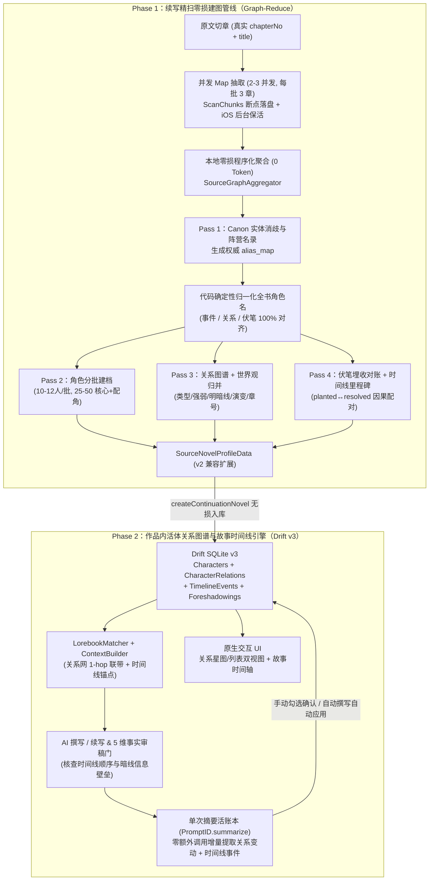

# 织命（ZhiMing-flutter）长篇续写精扫零损建图与活体关系图谱/故事时间线引擎架构设计

- **日期**：2026-11-21
- **路径分类**：Architectural（全链路统一架构，拆分为 Phase 1 与 Phase 2 两个独立可验收子阶段）
- **核心目标**：
  1. **Phase 1（精扫与统一图谱内核）**：根治长篇续写精扫中「角色/伏笔召回少、章号丢失、跨章对不上」的结构性缺陷，用「并发 Map + 本地零损程序化聚合 + 4 阶段专职归并（Graph-Reduce）」替代旧漏斗，并同步修复极速模式本地索引噪音；
  2. **Phase 2（作品内活体图谱与时间线引擎）**：在 Drift SQLite v3 中建立一等公民「人物关系表」与「故事时间线表」，实现续写建书无损入库、写作期零额外 API 调用的活账本自动演进、Lorebook/5 维事实审稿深度联动，以及纯 Flutter 原生交互式关系图谱与故事时间轴视图。

---

## 0. 问题背景与实测诊断

基于《诡异降临：开局白捡一只可爱萝莉》（250 章 / 610,699 字）与 `deepseek-v4.1-flash-1017` 的实测，现有续写精扫链路存在 4 个已证实的结构性瓶颈：

1. **Reduce 阶段静默丢弃 >60% 章节**：`SourceScanController` 攒满 `_reduceBatchSize = 40` 块后调用 `SourceReducer.batchPrompt(..., batchChars: 12000)`；实测单章 `MicroSummary` 均长 `1,039` 字，40 章格式化后约 `31,173` 字，超过 `12000` 字后的约 24 章被 `break` 静默丢弃且水位线照常推进。
2. **真实章号在 Reduce 中彻底消失**：`SourceReducer._formatMicro` 每批重新按 `[1]..[40]` 编号；`full` 模式长章拆分 `part` 时向 `SourceBatchHelper` 传入块序 `pos + 1` 而非真实章号 `chapterIndex + 1`，导致终归并阶段无法还原 `plantedChapter` 与 `chapterRange`。
3. **“散文压散文 + 单一巨型 JSON 出口”造成严重坍塌**：40 章压成 `<=1500` 字散文（均摊 37 字/章），最终 250 章又硬塞进单次 `continuationPrompt` 输出，迫使模型压缩为 8–12 个角色与 5–8 条伏笔；且 Map 阶段缺少 `aliases`、`relations` 与伏笔回指线索，跨章实体与伏笔埋收无法对齐。
4. **建书入库二次失真与极速索引噪音**：`createContinuationNovel` 将关系 `.take(4)` 压扁进 `background` 纯文本、直接丢弃 `arc`、且无独立时间线表；极速模式 `NovelLocalIndexer` 在实测书 Top 20 实体中混入 6 个动作噪音（`莫烬急忙`、`莫烬继续`、`莫烬再次`、`开口`、`转过头来`、`默默`），把真实角色挤出榜单。

### 明确的非目标（YAGNI 边界）
- 不引入外部 Embedding 模型或向量数据库，保持「单 OpenAI 兼容模型即开即用、纯本地 SQLite」定位；
- 不实现存量旧书/已有草稿的批量回溯补扫入口（聚焦新续写精扫与后续创作演进）；
- 不引入 WebView / Three.js / D3.js，可视化全部采用纯 Flutter 原生绘制以保证 Windows 与 iOS 一致流畅。

---

## 1. 整体闭环架构



---

## 2. 模块一：续写精扫与零损建图管线（Phase 1）

### 2.1 真实章号锚定与并发 Map

- **切块器修正（`lib/domain/source/source_scan_chunker.dart`）**：
  - `SourceScanChunk` 新增字段 `chapterTitle`（来自 `StyleChapterSampler.split` 的 `marker`）。
  - `chapterNo = chunk.chapterIndex + 1`（1-based 真实章号）；超长章（`>4000` 字）拆分为多块 `part` 时，所有子块共享同一个 `chapterIndex`，并携带 `partIndex` / `partCount`。
- **批量 Map 协议升级（`lib/domain/source/source_batch_helper.dart` & `source_micro_summarizer.dart`）**：
  - `BatchChapterInput` 统一传入真实 `chapterNo`（不再传 `pos + 1`）；同章拆块时标题标注 `第X章（第1/2段）`，落盘解析后由聚合器按 `chapterNo` 自动合并。
  - `MicroSummary` 向后兼容扩展（所有新增字段缺省为空集合/空值，旧 `ScanChunks` 缓存无需迁移即可直接反序列化）：
    ```json
    {
      "chapter": 50,
      "characters": [
        {"name": "林医生", "aliases": ["群星城第一炼金师"], "role_hint": "配角", "camp_hint": "星光之城", "traits": "轻浮厚脸皮的炼金术师", "state_change": "被赶出娼馆，与莫烬重逢"}
      ],
      "relations": [
        {"from": "莫烬", "to": "林医生", "relation": "欠债2000魂，对其有莫名熟悉感", "kind": "盟友", "line": "明线", "evidence": "林医生救过莫烬"}
      ],
      "events": [
        {"summary": "妃莉娅用提灯带莫烬穿过石门抵达星光之城", "in_world_time": "抵城当日", "participants": ["妃莉娅", "莫烬"], "importance": "major"}
      ],
      "worldbuilding": [
        {"name": "星光之城", "category": "地点", "content": "受城主庇佑可减低语，无居住资格者钟声响起会被送出"}
      ],
      "foreshadowing": [
        {"summary": "莫烬觉得林医生长相没见过却有身体上的熟悉感", "planted": true, "characters": ["莫烬", "林医生"], "target_hint": ""}
      ]
    }
    ```
  - 规则明确约束：当 `planted == false`（伏笔回收/揭示）时，模型必须在 `target_hint` 中简述「回收了前期哪条悬念」，用于 Pass 4 精准配对。
- **并发调度（`lib/features/source_archive/source_scan_controller.dart`）**：
  - 新增参数 `concurrency`（默认 `3`，UI 允许调 `1~4`），使用固定大小异步工作池并行处理未完成的 Map 批次（每批默认 `batchSize = 3` 章）。
  - 单批失败自动退避重试最多 2 次；失败/暂停时所有已完成批次保留在 `ScanChunks`，续跑跳过已完成块；完整保留现有 `BackgroundKeepAliveService`（iOS 后台保活）与换模型续跑逻辑。

### 2.2 本地零损程序化聚合器（新增 `lib/domain/source/source_graph_aggregator.dart`）

彻底废弃 `SourceReducer.batchPrompt`（40 章压 1500 字 + `batchChars: 12000` 截断）。Map 全部完成后，本地 Dart 代码 0 Token 确定性汇总全书全部 `MicroSummary`，生成 `AggregatedSourceGraph`：

| 聚合产物 | 汇总逻辑与保留字段 |
|---|---|
| `characterCandidates` | 按名称聚合：`aliases`（集合）、`mentions`（提及章次）、`chapterNos`（有序集合，含 `firstChapter`/`lastChapter`/`recentHits`）、`roleHints`、`campHints`、`traits[]`、`stateChanges[(chapterNo, text)]`；先做一轮无损显式别名归并（若 B 出现在 A 的 `aliases` 中且 A 频次更高则预合并）。 |
| `rawEvents` | 全书事件按 `(chapterNo, seqInChapter)` 稳定排序，分配确定性 ID `ev_c{chapterNo}_{seq}`，保留 `inWorldTime`、`participants`、`importance`。 |
| `rawRelations` | 保留全部显式抽取的 `(chapterNo, from, to, relation, kind, line, evidence)`，并基于 `rawEvents.participants` 计算全书角色同章共现次数表 `cooccurrence`。 |
| `rawClues` | 保留全书全部伏笔记录，按 `planted == true`（埋设池）与 `planted == false`（回收池）索引，每条强制携带真实 `chapterNo`、`characters[]`、`summary`、`targetHint`。 |
| `rawWorldEntries` | 按词条名（忽略空格大小写）初步合并，保留来源章号集合与分类提示。 |

### 2.3 4 阶段专职归并管线（新增 `lib/domain/source/source_graph_reducer.dart`）

将过去塞在单次 JSON 里的任务拆分为 4 个职责单一、体积可控的 Pass。每个 Pass 产物序列化后写入现有 `ScanReduces` 表（利用约定 `seq` 区间实现零表结构改动的断点续跑），且所有调用强制 `maxTokens >= 12288`（适配推理模型 `reasoning_tokens`）并保留截断紧凑重试机制：

| Pass | `ScanReduces.seq` 断点键 | 输入与规模控制 | 输出与后处理 |
|---|---|---|---|
| **Pass 1：Canon 实体消歧与阵营名录** | `1000` | 按频次与跨章数排序的 Top 120 候选角色摘要表（`名｜别称｜跨章数｜首末章｜身份/阵营提示`，约 6k–10k 字） | 输出 `camps[]`（阵营表）、权威 `characters[]` 骨架（主名、`aliases[]`、`role`、`camp`、`stance`、`importance: major\|normal\|minor`）与 `not_characters[]`（噪音黑名单）。**随后本地代码构造 `aliasMap`，确定性重写 `AggregatedSourceGraph` 中全部事件、关系边、伏笔和候选池的角色名**，保证全书引用 100% 对齐。 |
| **Pass 2：角色分批建档** | `2000 + batchIdx` | 选出所有 `importance == major/normal` 或跨章出现 `>= 2` 次的角色（250 章目标 **25–50 人**，过滤一次性路人），按 **10–12 人/批**（最多 2 并发）喂入每人聚合的 `traits`、关键 `stateChanges`（续写模式额外附带截断处最后 3 章原文摘录） | 输出每名角色的完整 `CanonCharacter`（`oneLine`、`appearance`、`personality`、`abilities`、`currentState`、`arc[]`、`camp`、`stance`、`importance`），并由本地 `NovelLocalIndexer` 自动补入原话口癖 `voiceSamples`。 |
| **Pass 3A：关系图谱归并** | `3000 + batchIdx` | 将归一化后的 `rawRelations` 按无序角色对 `(min(A,B), max(A,B))` 聚合成时序证据链，仅保留双方均在权威角色表中的关系对；若超过 50 组则按角色聚簇拆为 2 批并发 | 输出结构化 `CanonRelationEdge[]`（`from`、`to`、`relationType`、`label`、`description`、`strength: 1..5`、`line: 明线\|暗线`、`firstChapter`、`lastChapter`、`evolution[{chapterLabel, state}]`、`evidence`），并同步回填至对应 `CanonCharacter.relationships` 保持兼容。 |
| **Pass 3B：世界观归并** | `3500` | 合并后的 `rawWorldEntries` 候选池（优先高频与核心设定，上限 14k 字） | 输出去重后的 15–30 条 `CanonWorldEntry`（含规范 `category` 与 2–6 个 Lorebook 触发 `keywords`）。 |
| **Pass 4A：伏笔生命周期对账** | `4000` | 归一化后的全书 `[埋]` 池 + `[收]` 池（按章序排列，每条带 `[第X章][角色]` 与 `targetHint`；若总条目超 100 条则先按重要度/跨章引用过滤或拆两段对账后合并） | 输出结构化 `CanonThread[]`：`title`、`detail`、`status: open\|partial\|resolved`、`plantedChapter`、`resolvedChapter?`、`involvedCharacters[]`、`relatedEventSummary`、`payoffDetail?`。续写模式保留全部 `open`/`partial` 伏笔（目标 20–40+ 条）及关键 `resolved` 历史伏笔。 |
| **Pass 4B：时间线里程碑与进行中主线** | `4500` | 归一化后的 `rawEvents`（优先 `major`/`normal` 事件，按每 15–25 章分组压缩，上限 18k 字）+ Pass 4A 的伏笔标题表 | 输出按时间排序的 15–35 条 `CanonEvent`（含精确 `chapterStart`/`chapterEnd`、`inWorldTime`、`phase`、`summary`、`participants[]`、`linkedClueTitles[]`、`importance`）及 3–6 条 `activeArcs`（截断处正推进主线）。 |

> **说明**：`ScanMode.fast`（快扫）复用同一套零损聚合 + 4-Pass 归并（仅 Map 切块保持首尾摘要），`ScanMode.full`（精扫）逐章全文 Map + 4-Pass 归并。`SourceReducer.finalPrompt` / `continuationPrompt` 保留仅用于 `ScanMode.evidence`（极速证据建档）与外部批量复制导入兼容。

### 2.4 极速证据建档本地索引噪音修复（`lib/domain/source/novel_local_indexer.dart`）

针对实测暴露的 `莫烬急忙`、`开口`、`转过头来` 等脏实体，在 `NovelLocalIndexer.fromChapters` 中增加两道零成本过滤：
1. **高频真名粘连剥离**：第一轮统计出高置信 2–3 字主名集合（如 `莫烬`、`妃莉娅`），若另一候选词以该主名开头且剩余 1–2 字为常见副词/动词（`急忙/继续/再次/连忙/赶紧/微微/轻轻/缓缓/冷冷/顿时/随即/立刻/直接/突然`），直接剔除该脏候选并将计数归并到原主名。
2. **动作/神态停用词补齐**：增补 `开口`、`转头`、`转过头来`、`回头`、`抬头`、`低头`、`点头`、`摇头`、`默默`、`眯着眼睛`、`眯起眼睛`、`眨了眨眼`、`深吸`、`冷哼` 等高频动作词，并将候选上限从 `20` 放宽至 `25`。

---

## 3. 模块二：统一数据契约与 Drift Schema v3（Phase 1 & 2 底座）

### 3.1 `SourceNovelProfileData` 兼容扩展（`lib/domain/models/source_profile_models.dart`）

全部新增字段采用**加性可选**设计，旧版存储于 `SourceProfiles.payloadJson` 的 JSON 可无损读取：

- `CanonCamp`（新增）：`{name, stance?, brief?}`
- `CanonCharacter` 新增：`camp?`、`stance?`、`importance`（`CanonImportance`，默认 `normal`）
- `CanonRelationEdge`（新增）：
  ```dart
  class CanonRelationEdge {
    final String from;
    final String to;
    final String relationType; // 亲友 | 盟友 | 爱恋 | 敌对 | 从属 | 竞争 | 未知
    final String label;        // 简短标签，如「追杀者 / 病娇执念」
    final String description;
    final int strength;        // 1..5
    final String line;         // '明线' | '暗线'
    final int? firstChapter;
    final int? lastChapter;
    final List<CanonRelationEvolution> evolution; // [{chapterLabel, state}]
    final String? evidence;
  }
  ```
- `CanonEvent` 新增：`id?`、`chapterStart?`、`chapterEnd?`、`inWorldTime?`、`linkedClueTitles`（默认 `[]`）
- `CanonWorldEntry` 新增：`keywords`（默认 `[]`）
- `CanonThread` 新增：`status`（`'open' | 'partial' | 'resolved'`，默认 `'open'`）、`resolvedChapter?`、`involvedCharacters`（默认 `[]`）、`relatedEventSummary?`、`payoffDetail?`
- `SourceNovelProfileData` 新增：`camps`（默认 `[]`）、`relations`（默认 `[]`）

### 3.2 Drift SQLite Schema v2 → v3 无损迁移

在 `lib/core/database/tables.dart` 与 `app_database.dart` 中将 `schemaVersion` 升至 `3`：

#### 新增表 1：`CharacterRelations`（人物关系边表）
| 列名 | 类型 | 说明 |
|---|---|---|
| `id` | `text()` PK | UUID |
| `novelId` | `text()` FK → `Novels.id` (CASCADE) | 所属作品 |
| `sourceCharacterId` | `text()` FK → `Characters.id` (CASCADE) | 关系起点角色 ID |
| `targetCharacterId` | `text()` FK → `Characters.id` (CASCADE) | 关系终点角色 ID |
| `relationType` | `text()` default `'未知'` | 规范类型：`亲友 / 盟友 / 爱恋 / 敌对 / 从属 / 竞争 / 未知` |
| `label` | `text()` | 简短关系标签（画布边文字，如「契约伴侣」「宿敌」） |
| `description` | `text()` default `''` | 关系详细描述与背景 |
| `strength` | `integer()` default `3` | 羁绊/冲突强度 `1..5` |
| `line` | `text()` default `'明线'` | `'明线'`（公开关系）或 `'暗线'`（隐藏/单方不知情/秘密关联） |
| `status` | `text()` default `'active'` | `'active'` / `'broken'` / `'hidden'` |
| `evolutionJson` | `text()` default `'[]'` | 关系演变时间轨迹：`[{"chapterLabel":"第50章","state":"初次重逢欠债"}]` |
| `firstChapterOrder` | `integer().nullable()` | 首次确立关系章序 |
| `lastChapterOrder` | `integer().nullable()` | 最近演变章序 |
| `updatedAt` | `dateTime()` | 更新时间 |

#### 新增表 2：`TimelineEvents`（故事时间线表）
| 列名 | 类型 | 说明 |
|---|---|---|
| `id` | `text()` PK | UUID |
| `novelId` | `text()` FK → `Novels.id` (CASCADE) | 所属作品 |
| `volumeId` | `text().nullable()` | 可选关联卷 ID |
| `chapterId` | `text().nullable()` | 可选关联章节 ID（用于一键跳章） |
| `chapterOrder` | `integer().nullable()` | 1-based 全局章序（时间轴主排序键） |
| `chapterRange` | `text().nullable()` | 阶段型事件的章号范围（如 `第49-55章`） |
| `inWorldTime` | `text().nullable()` | 书内时间标签（如 `2029年7月8日`、`降临后第12天夜`） |
| `phase` | `text().nullable()` | 剧情阶段/篇名 |
| `title` | `text()` | 事件短标题（≤20 字） |
| `summary` | `text()` default `''` | 事件摘要与因果结果 |
| `location` | `text().nullable()` | 发生地点 |
| `participantsJson` | `text()` default `'[]'` | 参与角色名数组（JSON） |
| `linkedForeshadowingIdsJson` | `text()` default `'[]'` | 关联伏笔 ID 数组（JSON） |
| `importance` | `text()` default `'normal'` | `'major'` / `'normal'` / `'minor'` |
| `sortOrder` | `integer()` default `0` | 同章内事件排序 |
| `createdAt` | `dateTime()` | 创建时间 |

#### 存量表增量列（`onUpgrade` `from < 3` 执行 `createTable` + `addColumn`）
- `Characters` 新增 3 列：`camp`（`text().nullable()`）、`role`（`text().nullable()`）、`arcJson`（`text().withDefault(const Constant('[]'))`）。
- `Foreshadowings` 新增 3 列：`involvedCharactersJson`（`text().withDefault(const Constant('[]'))`）、`resolvedChapterOrder`（`integer().nullable()`）、`payoffDetail`（`text().nullable()`）。
- `NovelBundle`（`lib/domain/models/novel_domain.dart`）与 `NovelRepository.loadBundle` 同步加载 `relations: List<CharacterRelation>` 与 `timelineEvents: List<TimelineEvent>`。

### 3.3 续写建书无损入库（`lib/features/source_archive/source_injection_helper.dart`）

升级 `createContinuationNovel`，消除全部二次失真：
1. **角色全量入库**：写入全部 `profile.characters`（含 `camp`、`role`、`arcJson`），并建立 `canonicalName/alias → characterId` 映射表；仅对 `importance == major` 及前 12 名核心角色设 `isSceneRelevant = true`，其余全部以 `isSceneRelevant = false` 入库由 `LorebookMatcher` 按需关键词激活（既全量保留又不撑爆上下文）。
2. **关系边直入 `CharacterRelations`**：遍历 `profile.relations`，经 `name → characterId` 映射写入结构化关系表；若某关系端点未在 `profile.relations` 中但存在于旧版 `character.relationships`，自动兼容兜底转换。
3. **伏笔带状态与关联角色直入 `Foreshadowings`**：保留 `status`（`open`/`partial`/`resolved`）、`plantedChapterOrder`、`resolvedChapterOrder`、`involvedCharactersJson`、`payoffDetail`，并按标题建立 `clueTitle → foreshadowingId` 映射。
4. **时间线直入 `TimelineEvents`**：遍历 `profile.timeline`，优先取 `chapterStart`（为空时从 `chapterRange` 提取首个数字兜底）自动关联到已导入原作卷的对应 `chapterId`（实现时间轴一键跳读原作章！），并将 `linkedClueTitles` 解析为 `linkedForeshadowingIdsJson`。
5. **世界观带触发词入库**：优先写入 `w.keywords`，为空时回退 `_extractWorldKeywords(w.name)`。

---

## 4. 模块三：写作期活体闭环联动（Phase 2）

保持与「路线 A 活账本」一致的设计哲学：**零额外 API 轮次、不破坏 Static-First KV 前缀缓存、严格职责边界**。

### 4.1 活账本零额外调用扩展（`PromptID.summarize` + `lib/domain/writing/chapter_ledger.dart`）

- 升级 `PromptID.summarize` 的单次 JSON Schema，新增 2 个可选数组（无变化时省略或给空数组）：
  ```json
  "relationship_deltas": [
    {
      "from": "角色A",
      "to": "角色B",
      "relation_type": "亲友|盟友|爱恋|敌对|从属|竞争|未知",
      "label": "简短关系标签（如：临时同盟/产生猜忌）",
      "strength": 4,
      "line": "明线|暗线",
      "change_note": "本章导致关系发生变化的事件一句话"
    }
  ],
  "timeline_events": [
    {
      "in_world_time": "书内时间（若正文有明确时间推进则填，否则省略）",
      "title": "本章核心事件短标题（≤18字）",
      "summary": "关键因果与结果（≤60字）",
      "location": "地点（可选）",
      "participants": ["角色A", "角色B"],
      "importance": "major|normal"
    }
  ]
  ```
- `PromptTemplates.summarize` 新增可选参数 `existingRelationHints`（仅列出涉及当前已出场角色的简短现有关系列表，≤20 条），便于模型在已有关系边上做增量演进而非重复造边。
- `ChapterLedgerExtraction` 新增 `relationshipDeltas: List<RelationshipDelta>` 与 `timelineEvents: List<NewTimelineEvent>`。
- `ChapterLedgerApplier.applyToDb` 写入规则：
  - **关系写回**：通过「规范名 + 别名忽略空格匹配」将 `from`/`to` 解析为 `Character.id`（若双方任一方是本章刚勾选入库的 `newCharacters`，先写新角色再写关系！）；若两角色之间已存在同向/无向关系边则更新 `label`/`relationType`/`strength`/`line`/`lastChapterOrder` 并向 `evolutionJson` **追加**一条演变记录（不覆盖历史）；否则新建边。
  - **时间线写回**：同章去重后写入 `TimelineEvents`，自动绑定当前 `volumeId`、`chapterId`、`chapterOrder`。
- **交互**：手动编辑器摘要弹窗增加「关系变动」「时间线事件」勾选分组（默认全选）；`AutoWriteSheet` 自动应用并在进度日志输出更新计数（如 `活账本已更新：2 处角色状态，1 条关系演变，1 条时间线`）。

### 4.2 Lorebook 与 ContextBuilder 增强（KV 前缀缓存友好）

- **`LorebookMatcher`（`lib/domain/writing/lorebook_matcher.dart`）**：
  - `LorebookSelection` 新增 `relations: List<db.CharacterRelation>`。
  - 匹配规则：从 `bundle.relations` 中筛选出「**两端角色均已入选**」或「**任一端为本章关键词触发角色且 `strength >= 4` 或 `line == '暗线'`**」的关系边（上限 `12` 条），按 `id`/创建序稳定排序，不破坏 KV 缓存前缀；若暗线/强关联边牵出未入选的关键角色且名额未满，自动将其补入角色列表（1-hop 联带召回）。
- **`ContextBuilder.buildContinueContext`（`lib/domain/writing/context_builder.dart`）**：
  - 在 `staticOptional` 新增 `【人物关系网（含明暗线）】` 块（如 `- 莫烬 ↔ 爱丽丝［敌对·暗线·强度5］：追杀与执念（最新：…）`），位于角色状态与世界观之间，保持同卷静态前缀高命中率。
  - 在 `dynamicHigh` 新增 `【故事时间线锚点】` 块：取当前章之前的**最近 4 条时间线事件 + 关键 `major` 里程碑（最多 4 条，去重，按章序排列）**，显式展示 `[第X章 | 书内时间] 标题：摘要`，让写作模型清晰掌握时间推进与近期因果。
- **`ContinuationContext`（`lib/domain/source/continuation_context.dart`）**：
  - 同步渲染精扫产出的高强度/暗线关系边与带 `status` 的未回收/部分推进伏笔，提升续写立项蓝图阶段的上下文完整度。

### 4.3 5 维事实审稿拦截门增强（`lib/domain/writing/fact_review_service.dart`）

- `FactReviewService.review` 核查上下文中补充注入：
  1. 本章登场角色关联的 `activeRelations`（重点标出 `【暗线/秘密】` 关系，帮助 `character` 维度精准拦截「角色提前知道暗线秘密」的信息壁垒违例与关系 OOC）；
  2. 最近 6 条 `TimelineEvents`（含 `inWorldTime` 与地点，帮助 `timeline` 维度精准拦截「昨夜/三日后时间错乱」「刚在A地又瞬移到B地」的时空矛盾）。

---

## 5. 模块四：纯 Flutter 原生交互图谱与故事时间线 UI（Phase 2）

### 5.1 信息架构落点（克制导航，不新增顶栏主分区）

保持 `NovelWorkspacePage` 现有 4 分区（写作 / 大纲伏笔 / 设定集 / 助手）干净结构，将新视图自然融入对应分区：
- **设定集（`BookSettingsView`）**：3 段 → 4 段切换：`作品信息 | 角色卡 | 关系图谱 | 世界观`。
- **大纲伏笔（`OutlineAndForeshadowView`）**：2 段 → 3 段切换：`卷章大纲 | 伏笔台账 | 故事时间线`；同时升级「伏笔台账」卡片，展示 `状态胶囊（未回收 / 部分推进 / 已回收）`、`第X章埋 → 第Y章收` 跨度与关联角色胶囊。
- **原作档案详情（`SourceProfileDetailDialog`）**：4 Tab → 5 Tab：`人物 | 关系图谱 | 时间线 | 世界观 | 伏笔与弧线`，直接复用同一套图谱与时间轴展示组件，精扫完毕即可立刻检视整本书的人物星图与时间脉络。

### 5.2 原生交互式人物关系图谱组件（新增 `lib/core/widgets/character_graph_canvas.dart`）

- **纯 Dart 布局算法（零外部依赖，50 节点计算 <10ms）**：
  - 接收通用视图模型 `GraphNode`（id/name/camp/role/importance/degree）与 `GraphEdge`（id/fromId/toId/type/label/strength/line/description/evolution），使作品库与原作档案无缝复用。
  - 采用**阵营扇区初始化 + 确定性 Fruchterman-Reingold 力导向迭代（80 轮）**：同阵营节点天然聚拢成星团，核心主角团居于中心，固定随机种子保证重绘稳定不跳动。
- **视觉编码**：
  - 节点大小与光环亮度 = 重要度 + 连接度；节点色环 = 阵营配色；
  - 边颜色 = 关系类型（亲友/盟友=青蓝、爱恋=暖粉、敌对=绯红、从属=琥珀、竞争=紫、未知=灰）；边粗细 = `strength`（1–5）；**实线 = 明线，虚线 = 暗线**。
- **双视图与交互**：
  - 顶部筛选与工具条：阵营下拉筛选、关系类型筛选、「仅看暗线」切换、角色名搜索定位、**「星图画布 / 关系列表」**一键切换、以及「新增关系」按钮（编辑模式下可用）。
  - 画布基于 `InteractiveViewer` + `CustomPainter` 支持双指缩放/滚轮缩放、拖拽平移、节点单独拖拽微调。
  - **点击节点**：高亮该节点及 1-hop 关联边（其余节点降透明），桌面端右侧抽屉 / 移动端底部 Sheet 展开该角色信息、所有关联边及关系演变轨迹；
  - **点击边或列表项**：查看关系详情、历史演变时间点，并支持编辑/删除。

### 5.3 故事时间线视图组件（新增 `lib/core/widgets/story_timeline_view.dart`）

- 同样采用通用视图模型 `TimelineEventItem`，复用于「大纲伏笔 → 故事时间线」与「原作档案详情 → 时间线」。
- 顶部筛选条：按角色筛选、按重要度（仅看核心 `major` / 全部）筛选、关键词检索、以及「新增事件」按钮（作品内可用）。
- 垂直时间轴按 `phase`（剧情阶段）分节，每张事件卡显示：
  - 左侧轨道节点（`major` 为实心强调色圆点，`normal`/`minor` 为空心小圆点）+ 章号胶囊（`第X章` 或 `第X-Y章`）+ 书内时间徽章（如 `降临前3天`）；
  - 事件标题与摘要、发生地点；
  - 底部参与角色胶囊（点击即按该角色过滤时间轴）+ 关联伏笔 `[埋]`/`[收]` 徽章；
  - 在作品工作台中，点击章号胶囊通过 `OutlineAndForeshadowView(onJumpToChapter: ...)` 回调通知 `NovelWorkspacePage` 切回「写作」分区并选中对应章节（桌面端直接切换编辑器，移动端推入章节编辑页）。

---

## 6. 分阶段实施与验证验收计划

### 实施分期
- **Phase 1（精扫与统一图谱内核）**：
  - 升级 `SourceScanChunker`、`SourceMicroSummarizer`、`SourceBatchHelper`、`SourceNovelProfileData`、`NovelLocalIndexer`；
  - 实现 `SourceGraphAggregator`、`SourceGraphReducer`（4 Pass + 断点）与 `SourceScanController` 并发 Map 改造；
  - 完成 Phase 1 单元测试 + 用《诡异降临》250 章实测验证精扫质量。
- **Phase 2（作品内活体图谱、时间线与可视化）**：
  - Drift Schema v3 迁移（`CharacterRelations`、`TimelineEvents` 及增量列）+ `build_runner` 代码生成；
  - 升级 `SourceAndStyleBridge.createContinuationNovel`、`ChapterLedger`、`PromptDefaults.summarize`、`LorebookMatcher`、`ContextBuilder`、`FactReviewService`；
  - 实现 `CharacterGraphCanvas`、`StoryTimelineView` 并接入 `BookSettingsView`、`OutlineAndForeshadowView`、`SourceProfileDetailDialog`、`NovelWorkspacePage`。

### 测试与验收标准
1. **单元测试（纯 Dart + 内存 Drift DB）**：
   - 新增 `test/source_graph_pipeline_test.dart`：验证长章拆块真实章号合并、`SourceGraphAggregator` 零损聚合与显式别名归并、`aliasMap` 确定性重写（事件/关系/伏笔全对齐）、4-Pass 断点恢复、以及 `NovelLocalIndexer` 过滤《诡异降临》同款动作词噪音。
   - 新增 `test/living_story_graph_test.dart`：验证 Drift v2→v3 无损迁移、`CharacterRelations` 与 `TimelineEvents` 级联删除、续写无损入库、`ChapterLedgerApplier` 关系演变追加（不覆盖旧历史）与时间线去重写入、`LorebookMatcher` 关系边及暗线 1-hop 召回、`FactReviewService` 关系与时间线上下文注入。
   - 扩充 `test/ui_regression_test.dart`：验证 `CharacterGraphCanvas`（力导向稳定布局、节点点击高亮、画布/列表切换）与 `StoryTimelineView`（筛选、增删改）在桌面端（1280×800）与手机端（390×844）均无溢出与生命周期异常。
2. **真书端到端实测验收（《诡异降临：开局白捡一只可爱萝莉》250 章 + `deepseek-v4.1-flash-1017`）**：
   - 全书 250 章 0 静默丢章，并发 Map 总耗时显著下降；
   - 最终档案产出：**≥25 名归一化角色**（无动词噪音、别名如 `罗娜/小黑猫` 正确合一）、**≥25 条结构化关系边**（含明/暗线）、**≥20 条带精确章号与埋/收状态对账的伏笔**、**≥15 条时间线里程碑**；
   - 一键创建续写作品后，全部角色、关系、时间线、伏笔无损落库且图谱/时间轴可正常交互。
3. **工程静态与构建验收**：`dart run build_runner build --delete-conflicting-outputs`、`flutter analyze` 0 问题、`flutter test` 全绿。
