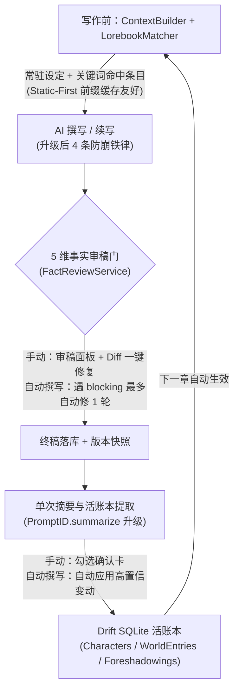

# 织命（ZhiMing-flutter）长篇记忆与防吃书引擎架构设计（路线 A + 防崩提示词升级）

- **日期**：2026-11-21
- **目标**：在不增加多余 API 轮次与不破坏 KV 前缀缓存的前提下，补齐长篇连载最核心的三块一致性能力——**活账本自动回写（Living Ledger）**、**关键词触发世界书（Just-in-Time Lorebook）**、**5 维事实审稿拦截门（Fact Review Gate）**，并同步升级内置防崩写作提示词与本地 AI 腔检测库。

---

## 1. 整体数据流与闭环架构

### 核心设计约束
1. **单次零增量提取**：活账本状态变动与摘要/伏笔在同一轮 `summarize` 请求中完成，不增加额外 API 调用。
2. **职责严格解耦**：5 维事实审稿只查**可验证的客观事实与逻辑矛盾**（`setting / timeline / continuity / character / logic`），绝不越界评价主观文笔（文笔归 `StyleEvaluator` 负责）。
3. **推理模型安全预算**：所有结构化 JSON 调用（`summarize`、`factReview`、`applyBlockingFixes`）一律使用 `maxTokens >= 12288`，避免 `reasoning_tokens` 耗尽输出。
4. **SQLite 平滑升级**：`AppDatabase.schemaVersion` 从 `1` 升至 `2`，通过 `onUpgrade` 增量 `addColumn` 无损迁移，不破坏现有本地书库数据。

---

## 2. 模块拆解与详细设计

### 模块一：Schema v2 与关键词触发世界书（`LorebookMatcher`）

#### 数据层变更（`lib/core/database/tables.dart` & `app_database.dart`）
- `WorldEntries` 表新增 2 列：
  - `keywordsJson`：`text().withDefault(const Constant('[]'))` — 触发词列表（JSON 字符串数组）。
  - `isAlwaysOn`：`boolean().withDefault(const Constant(false))` — 常驻开关（如核心力量体系/世界基本法则，无论关键词是否命中始终注入）。
- `AppDatabase.schemaVersion` 升至 `2`；`MigrationStrategy.onUpgrade` 在 `from < 2` 时执行 `m.addColumn(worldEntries, worldEntries.keywordsJson)` 与 `m.addColumn(worldEntries, worldEntries.isAlwaysOn)`。

#### 匹配逻辑（新增纯 Dart 单元 `lib/domain/writing/lorebook_matcher.dart`）
- **输入**：`NovelBundle` + 扫描语料 `probeText`（由 `[本章细纲, 场景卡文本, 上一章末尾 600 字, 本章已写末尾 800 字]` 拼接而成）。
- **角色匹配**：
  1. 始终纳入 `isSceneRelevant == true` 的常驻角色；
  2. 扫描其余所有角色的 `name` 与 `aliases`，凡在 `probeText` 中出现即自动纳入；
  3. 按原 `sortOrder` 稳定排序（保证同卷内静态前缀顺序稳定，利于 KV 缓存），上限提升至 `16` 名（原为 12）。
- **世界观匹配**：
  1. 始终纳入 `isAlwaysOn == true` 的常驻条目；
  2. 扫描其余所有条目的 `name` 与 `keywords`（解析 `keywordsJson`），凡在 `probeText` 中命中即纳入；
  3. 兜底：若既无常驻条目又无任何关键词命中（例如全新空白章），回退取前 `6` 条世界观条目避免上下文空白；
  4. 按原 `sortOrder` 稳定排序，彻底突破原 `.take(8)` 硬截断（上限放宽至 `16` 条并受 `ContextBuilder` 总字数预算控制）。
- **UI 联动（`lib/features/settings_book/book_settings_view.dart`）**：世界观编辑弹窗增加「触发关键词（逗号/顿号分隔）」输入框与「常驻注入（每章必带）」开关，列表卡片显示「常驻」或关键词数量小徽章。

---

### 模块二：活账本单次提取与写回（`ChapterLedgerService`）

#### 数据模型（新增纯 Dart 单元 `lib/domain/writing/chapter_ledger.dart`）
扩展章节摘要解析产物 `ChapterLedgerExtraction`：
- 原有字段完全向后兼容：`summary`、`keyFacts`、`newForeshadowings`、`resolvedForeshadowingTitles`
- 新增活账本字段（全部可选，缺省为空数组）：
  - `characterDeltas`：List of `CharacterStateDelta`（`name`、`currentLocation?`、`physicalState?`、`mentalState?`、`currentGoal?`、`note?`）— 仅记录本章发生实质变化的字段，未变化字段留空不覆盖！
  - `newCharacters`：List of `NewCharacterEntry`（`name`、`appearance?`、`personality?`、`background?`）— 仅收录本章新登场且后续可能复用的有名字角色（跳过路人甲）。
  - `newWorldEntries`：List of `NewWorldEntry`（`category`、`name`、`content`、`keywords`）— 仅收录本章新确立的长期世界观规则/重要道具/势力/地点。
- `ChapterLedgerApplier.applyToDb(...)`：
  - 支持传入勾选集合（手动模式按用户勾选逐项写入；自动撰写模式全量写入高置信项）。
  - 角色匹配复用别名不区分空格匹配；仅覆写非空变化字段，同时更新 `lastSeenChapterTitle`；同名角色/世界观去重，绝不重复建卡。

#### 提示词与调用升级
- 升级 `PromptID.summarize`：在单次 JSON Schema 中补充上述 3 个可选数组，明确指令“只记录不可逆的跨章事实变化，未变化的字段省略，路人甲不入库”。
- `PromptTemplates.summarize` 新增可选参数 `existingCharacters`（角色名列表）与 `openForeshadowings`（待回收伏笔标题列表），让模型一次完成**名称消歧**与**伏笔精准核销**！

#### 交互体验（混合模式）
- **手动编辑器（`ChapterEditorWidget._openSummarySheet`）**：生成摘要后，在摘要弹窗底部若检测到角色状态变动、新角色、新设定或伏笔回收建议，展示分项复选框列表（默认全选，用户可取消勾选任意条目），一键点击「保存摘要并写入活账本」完成更新。
- **自动撰写（`AutoWriteSheet`）**：每章摘要完成后自动调用 `ChapterLedgerApplier.applyToDb`，并在流水线日志中反馈更新条数（如 `活账本已更新：2 处角色状态，1 条新伏笔`），下一章立即继承最新角色状态。

---

### 模块三：5 维事实审稿拦截门（`FactReviewService`）

#### 提示词与模型（新增 `PromptID.factReview` + `lib/domain/writing/fact_review_service.dart`）
- 新增第 25 套内置提示词 `PromptID.factReview`（归类于「写作」，支持在开发者工坊覆写）：
  - 严格限定只审查 **5 个客观可验证维度**：
    1. `setting`（设定一致性：能力/境界/物品/规则是否与世界观冲突）
    2. `timeline`（时间线：与上章时间衔接、角色分身、倒计时推进）
    3. `continuity`（叙事连贯：上章钩子回应、场景转换过渡、情绪突变）
    4. `character`（角色一致性与**知识边界**：性格动机 OOC、隔空知道不在场的情报）
    5. `logic`（因果逻辑：决策动机、战力对比、事件因果）
  - 强制输出 `dimension_results`（全部 5 维，无问题显式写 `"pass"`）与 `issues[]`（含 `severity`、`category`、`location`、`description`、`evidence`、`fix_hint`、`blocking`）。
  - 强制边界：**不打主观文笔分、不提脑洞剧情建议、每条 issue 必须有原文引用 vs 档案对比证据**。
- `FactReviewService`：
  - `review(...)`：组装精简核查上下文（命中世界书 + 登场角色状态 + 上章末尾 + 本章细纲 + 待检正文），以 `temperature: 0.15, maxTokens: 12288` 产出 `FactReviewResult`。
  - `applyFixes(...)`：仅针对选定/blocking 问题生成定向修复稿，严格要求“只修列出的事实矛盾，保留其余正文不动”，以 `maxTokens: max(provider.maxTokens, 12288)` 输出。

#### 交互体验（混合模式）
- **手动编辑器（`ChapterEditorWidget` + 新建 `lib/features/editor/fact_review_sheet.dart`）**：
  - 编辑器底部工具栏在「风格体检」旁新增「事实审稿」按钮。
  - `FactReviewSheet` 顶部以 5 颗状态胶囊展示 5 维结论（绿勾 `pass` / 红标阻断 / 黄标提醒），下方展示带「原文 vs 档案证据」卡片与修复方向；存在问题时支持勾选问题后点击「一键按证据修复」→ 弹出 **Diff 对比弹窗** → 确认前自动建版本快照再替换。
- **自动撰写（`AutoWriteSheet`）**：
  - 表单新增开关「开启 5 维事实审稿拦截门（默认开启）」。
  - 每章写完正文后先跑 `FactReviewService.review`：
    - 无 `blocking` 问题 → 直接进入摘要与活账本回写；
    - 存在 `blocking` 问题 → 自动执行 **至多 1 轮** `FactReviewService.applyFixes`（修复前存快照），修复后直接落库并记录日志，若仍存疑则标注待人工复查，绝不无限循环烧 Token。

---

### 模块四：内置写作防崩提示词与 `ProseChecker` 同步升级

1. **升级 `PromptID.writing` 与 `PromptID.continueWriting`**：补入 4 条实测高价值约束：
   - **信息壁垒**：严禁角色提及或暗示自己不在场/未被告知的情报；
   - **禁止照抄细纲**：细纲与场景卡仅作导演分镜，严禁原句照搬细纲表述或示例台词；
   - **角色声带隔离**：去掉说话标签后仍能从用词与口癖分辨说话人，禁止全员共用统一书面腔；
   - **拒绝强行升华与电报短句链**：禁止章末/段末套用“命运的齿轮/真正的考验才刚开始”式哲理升华，禁止机械三连排比与无因果短句堆叠。
2. **扩充 `PromptID.antiAIFlavor`、`PromptID.antiAIInline` 与 `ProseChecker`**：
   - 本地 `ProseChecker` 增补实测高频 AI 指纹检测：对举/递进套话（`不仅…而且…`、`这不仅仅是…更是…`）、空洞抽象词（`某种难以言喻`、`一丝不易察觉`、`空气仿佛凝固`）、强行升华句（`命运的齿轮`、`真正的考验`、`一切才刚刚开始`）。

---

## 3. 测试与验收计划

1. **单元测试（纯 Dart + 内存 Drift DB，覆盖全部新增单元）**：
   - `test/database_and_blob_test.dart`：验证 Schema v2 新增列默认值与升级兼容性。
   - 新增 `test/living_ledger_and_review_test.dart`：
     - `LorebookMatcher`：验证常驻注入 + 别名/关键词精准触发 + 超出 8 条世界观时仍精准召回第 20 条 + 无命中兜底。
     - `ChapterLedgerExtraction` & `ChapterLedgerApplier`：验证单次摘要 JSON 宽容解析、部分勾选回写、角色增量字段不覆盖未变字段、同名去重。
     - `FactReviewResult` & `FactReviewService`：验证 5 维 `dimension_results` 与 `blocking` 判定解析、空问题通过、阻塞触发修复回调。
     - `ProseChecker`：验证新增中文 AI 指纹词命中。
2. **真实 API 端到端回归**：使用 `deepseek-v4.1-flash` 实测「活账本单次提取」与「5 维事实审稿门」（故意植入一条隔空知情/时间线错乱的假 Bug，验证审稿门能精准带证据抓出来并拦截！）。
3. **编译验证**：`flutter analyze` 0 问题 + `flutter test` 全绿 + 本地 Windows Release 重建 + 推送 GitHub Actions 产出最新 Windows & iOS `.ipa`。
